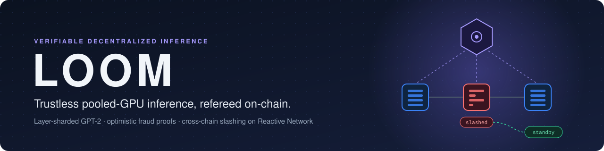
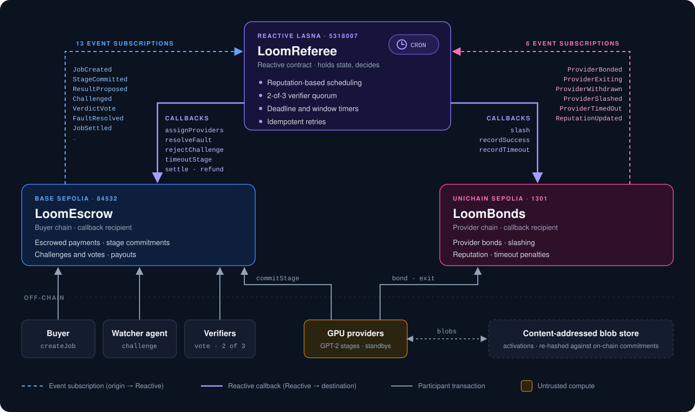
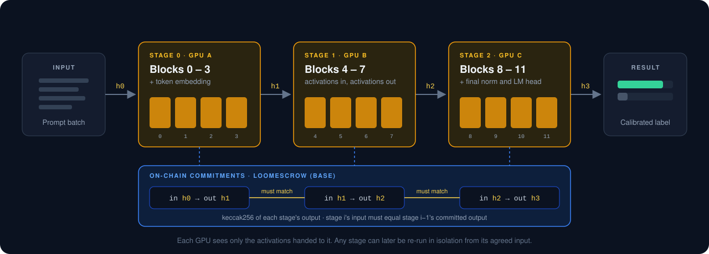
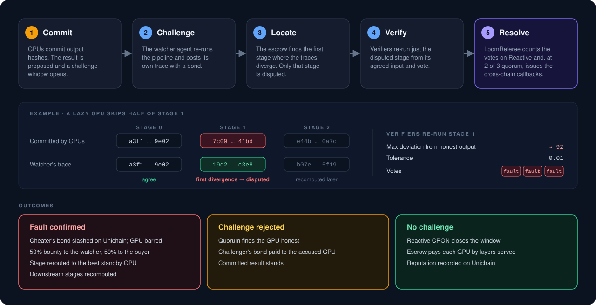

<p align="center">
  
</p>

<p align="center">
  <a href="https://github.com/Shivanikinagi/Loom/actions/workflows/ci.yml"></a>
  <a href="LICENSE"></a>
  
  
  
</p>

<p align="center">
  <a href="#overview">Overview</a> ·
  <a href="#architecture">Architecture</a> ·
  <a href="#dispute-resolution">Dispute resolution</a> ·
  <a href="#quick-start">Quick start</a> ·
  <a href="#deployment">Deployment</a> ·
  <a href="#security-model">Security model</a>
</p>

---

## Overview

LOOM runs one AI model across several untrusted community GPUs, each serving a
slice of its layers, and makes the result verifiable without a trusted
operator.

Every GPU commits a hash of the activations it produced. If anyone challenges
the answer, a reactive contract on **Reactive Network** referees the dispute
across chains: it identifies the GPU that cheated, slashes its bond on another
chain, rewards whoever caught it, pays the honest GPUs and reroutes the
cheater's layers to a standby. No keeper bot, backend or human is involved
once a job is posted.

### The problem

Pooled-GPU inference (one model sharded by layers across many inexpensive
machines) makes large models affordable, but nobody can tell whether each
machine actually ran its layers. A GPU that skips half its work still produces
a plausible-looking answer, and with several GPUs in a pipeline it isn't even
clear which one was at fault. Today the options are to trust the operators or
to run a central checker.

### The approach

| | |
|---|---|
| **Split** | GPT-2 is cut into three stages. Each GPU sees only the activations handed to it. |
| **Commit** | Each stage's input and output hashes are committed on-chain, forming an unbroken hash chain. |
| **Challenge** | A watcher agent re-runs the pipeline and disputes the first stage it can't reproduce. |
| **Verify one stage** | Verifiers re-run only the disputed stage from its agreed input, not the whole model. |
| **Referee** | A reactive contract counts votes, slashes, reroutes and settles across three chains. |

---

## Architecture

<p align="center">
  
</p>

| Contract | Chain | Responsibility |
|---|---|---|
| `LoomReferee` | Reactive Lasna (5318007) | Reactive contract. Mirrors jobs and providers from events and makes every protocol decision. |
| `LoomEscrow` | Base Sepolia (84532) | Buyer chain. Escrowed payments, stage commitments, challenges, votes and payouts. |
| `LoomBonds` | Unichain Sepolia (1301) | Provider chain. Bonds, slashing, timeout penalties and reputation. |

### Inference pipeline

<p align="center">
  
</p>

GPT-2 is split into embedding + blocks 0–3, blocks 4–7, and blocks 8–11 + LM
head. Each GPU stores its output blob in a content-addressed store and commits
its keccak256 on Base. The escrow enforces the chain: stage *i*'s input must
equal stage *i‑1*'s committed output. Because every intermediate result is
pinned, any single stage can be re-executed in isolation.

### Why the referee is a reactive contract

`LoomReferee` is not a relay. It holds the protocol's state and makes every
decision after a job is posted:

| Decision | Inputs (events) | Output (callbacks) |
|---|---|---|
| Who runs each stage | Bonds and reputation from **Unichain** | `assignProviders` on **Base** |
| Is a stage faulty | Verifier votes from **Base**, counted to quorum | `resolveFault` / `rejectChallenge` on **Base** |
| Punish the cheater | `FaultResolved` on **Base** | `slash` on **Unichain** |
| Missed deadline | Its own CRON clock | `timeoutStage` on **Base**, then `recordTimeout` on **Unichain** |
| Window closed | Its own CRON clock | `settle` on **Base**, then `recordSuccess` on **Unichain** |
| Instruction lost or early | No confirming event yet | Retried from CRON (destinations are idempotent) |

It listens on two origin chains and writes to two destination chains. It
subscribes to CRON **only while a job has a live timer** and unsubscribes when
nothing is pending, because CRON is billed on every tick.

---

## Dispute resolution

<p align="center">
  
</p>

1. **Commit.** GPUs commit their output hashes and the result is proposed,
   opening a challenge window.
2. **Challenge.** The watcher agent re-runs the pipeline. It accepts every
   stage it can reproduce and submits its own hash from the first stage it
   can't, along with a bond.
3. **Locate.** The escrow finds the first index where the two traces differ.
   Both sides agree on that stage's input, so only that stage is in dispute.
4. **Verify.** Verifiers re-run the disputed stage and vote. A lazy GPU
   diverges by roughly 92 against a 0.01 tolerance.
5. **Resolve.** At 2-of-3 quorum, `LoomReferee` wipes the faulty stage and
   everything after it, reroutes it to the best standby GPU, then slashes the
   cheater on Unichain once Base confirms. Unchallenged jobs settle when the
   window closes, paying each GPU by layers served.

| Outcome | Challenger | Accused GPU | Buyer |
|---|---|---|---|
| Fault confirmed | Bond returned + 50% of slashed bond | Entire bond slashed, barred | 50% of slashed bond, corrected result |
| Challenge rejected | Loses bond | Receives challenger's bond | Result stands |
| No quorum by deadline | Bond returned | No change | Result stands |

<details>
<summary><b>Full message sequence</b></summary>

```mermaid
sequenceDiagram
    autonumber
    participant B as Buyer
    participant E as LoomEscrow<br/>(Base Sepolia)
    participant R as LoomReferee<br/>(Reactive Lasna)
    participant G as GPUs 0..2
    participant W as Watcher agent
    participant V as Verifiers
    participant K as LoomBonds<br/>(Unichain Sepolia)

    K-->>R: ProviderBonded / ReputationUpdated (learns the GPU set)
    B->>E: createJob (payment escrowed)
    E-->>R: JobCreated
    R->>E: callback assignProviders (best-reputation bonded GPUs)
    G->>E: commitStage 0,1,2 (hash chain: out[i] = in[i+1])
    E-->>R: ResultProposed (challenge window)
    W->>W: re-runs the pipeline, finds stage 1 wrong
    W->>E: challenge (own trace + bond); divergence point = stage 1
    V->>E: vote (each re-ran stage 1 only)
    E-->>R: VerdictVote x2
    R->>E: callback resolveFault (quorum reached; reroute to standby GPU)
    E-->>R: FaultResolved
    R->>K: callback slash (bounty to watcher, compensation to buyer)
    G->>E: replacement recomputes stage 1, stage 2 recomputes
    Note over R: CRON: challenge window closes
    R->>E: callback settle (pay by layers served)
    E-->>R: JobSettled
    R->>K: callback recordSuccess (reputation)
```

</details>

---

## AI in the loop

The neural network is part of the running system, not a development tool:

- **The workload is GPT-2**, executed stage by stage on the provider GPUs
  (pure NumPy, float32).
- **Verifiers are model executions.** They are triggered by `Challenged`
  events, re-run the network, and their outputs determine what the reactive
  contract does next.
- **The watcher is an agent** that decides whether an audit is worth the
  compute (unproven GPUs always, proven ones sampled) and when a challenge is
  justified.

Zero-shot GPT-2 is biased towards "positive", so a content-free calibration row
runs through the pipeline alongside the real data
([Zhao et al., 2021](https://arxiv.org/abs/2102.09690)). This raises accuracy
on the bundled review set from 50% to 90%, and the calibration row is verified
like everything else.

---

## Quick start

Runs the complete protocol locally in about two minutes. Requires
[Foundry](https://getfoundry.sh) and Python 3.11+.

```bash
git clone --recurse-submodules https://github.com/Shivanikinagi/Loom && cd Loom
pip install -r requirements.txt
(cd contracts && forge build)
python -m loom.ml.fetch_model          # GPT-2 weights, 548 MB (or add --tiny below)

python -m loom local                   # 3 anvil chains, every actor, 3 scenarios
python -m loom local --interactive     # same network + live dashboard at http://127.0.0.1:8080
```

`python -m loom local` deploys to three anvil chains (with the real chain IDs
and callback proxy addresses), runs the **fraud**, **honest** and **timeout**
scenarios, checks the outcome on all three chains and writes
`evidence/local-run.md`. See [a sample run](evidence/local-sample.md).

Locally, `loom/local_reactive.py` stands in for Reactive Network by delivering
logs to `react()` and executing the callbacks. On testnet that file is not
used; Reactive Lasna drives the same contracts.

---

## Deployment

| Contract | Chain | Address |
|---|---|---|
| LoomReferee (reactive) | Reactive Lasna (5318007) | _pending_ |
| LoomEscrow | Base Sepolia (84532) | _pending_ |
| LoomBonds | Unichain Sepolia (1301) | _pending_ |

```bash
cp .env.example .env                       # LOOM_PRIVATE_KEY = a fresh testnet-only key
python -m loom preflight                   # checks RPCs, proxies and balances; reports what's missing
python -m loom faucet --eth 0.033          # Base Sepolia ETH -> lREACT on Lasna
python -m loom deploy   --network testnet
python -m loom fund     --network testnet  # tops up the derived role keys
python -m loom register --network testnet  # 5 GPUs bond on Unichain
python -m loom run      --network testnet --scenarios fraud,honest,timeout --dashboard
python -m loom evidence --network testnet  # evidence/testnet.md with explorer links
```

A single funded key drives every role: the buyer, challenger, five GPUs and
three verifiers use keys derived from it. In total it needs about 0.06 Base
Sepolia ETH (half is swapped for lREACT) and 0.016 Unichain Sepolia ETH. Gas on
both chains is a fraction of a gwei, so role wallets receive 0.001 ETH each and
jobs pay 0.001 ETH.

Without a mainnet balance, the
[Google Cloud faucet](https://cloud.google.com/application/web3/faucet/ethereum/sepolia)
and [QuickNode's Base faucet](https://faucet.quicknode.com/base/sepolia) work
for a fresh wallet, and Ethereum Sepolia ETH can be bridged to either chain
through its standard bridge.

---

## Testing

```bash
cd contracts && forge test           # 16 tests incl. fuzz + conservation
python -m pytest -m "not e2e"        # ML pipeline (real GPT-2 test runs if weights exist)
python -m pytest -m e2e              # full local network, all scenarios (~2 min)
```

The Foundry suite runs the whole loop through a simulated Reactive relay: logs
are delivered to `react()` from the system address, callbacks execute through
the proxy with the sender injected, and the proxy's gas overhead is withheld.
It covers the happy path, fraud caught and rerouted, frivolous challenges,
missed deadlines, no quorum, refunds, reputation-based scheduling, early and
duplicate callbacks, authentication, fee isolation, a settlement fuzz test,
and a conservation test that keeps every `react()` under Reactive's 900k gas
cap (worst case: 458k).

| Function | Gas (median) |
|---|---:|
| `createJob` | 167k |
| `commitStage` | 84k |
| `challenge` | 94k |
| `resolveFault` (callback) | 95k |
| `settle` (callback, 3 payouts) | 87k |
| `slash` (callback) | 60k |
| Worst-case `react()` | 458k |

---

## Design principles

- **Fees can't touch user funds.** Callback fees are paid only from the
  operating balance; escrow, challenge bonds and provider bonds are excluded
  (`LoomCallbackBase.locked()`).
- **Callbacks are idempotent.** A stale or early instruction emits
  `CallbackIgnored` instead of reverting, and the referee retries until the
  confirming event arrives. Clock skew between chains can delay an action but
  can't strand a job.
- **Offline isn't fraud.** A missed deadline costs a small fixed penalty and
  the stage is rerouted. Only a verifier quorum can slash.
- **Frivolous challenges cost the challenger.** If the quorum finds the GPU
  honest, the challenger's bond goes to the accused.
- **Cross-chain ordering.** Unichain is slashed only after Base confirms the
  fault, so the two chains can never disagree.

## Security model

- **Verifier set.** Verifiers are owner-managed and require 2 of 3 votes. A
  production deployment would bond verifiers and sample them per dispute.
- **Determinism.** Verification relies on deterministic inference on a common
  software stack (NumPy float32). Honest re-runs are bit-identical here, and a
  tolerance absorbs harmless drift. Heterogeneous hardware would need a
  reproducibility layer such as Gensyn's RepOps.
- **Data availability.** Blobs live in a content-addressed store that is
  untrusted for integrity (everything is re-hashed against the chain). A
  provider that withholds data is voted faulty.
- **Payments.** Payments are in native ETH on testnet.

### Prior art

Optimistic fraud proofs for ML ([opML](https://arxiv.org/abs/2401.17555)) and
re-executing only the disputed step
([Gensyn Verde](https://gensyn.ai/articles/verde)) inspired the dispute design.
LOOM applies these ideas to layer-sharded inference, with a reactive contract
as the cross-chain referee, settling in seconds rather than over a long dispute
game.

---

## Repository layout

```
contracts/src/LoomReferee.sol       Reactive contract (Lasna): scheduling, quorum, timers, retries
contracts/src/LoomEscrow.sol        Buyer chain (Base): jobs, commitments, challenges, votes, payouts
contracts/src/LoomBonds.sol         Provider chain (Unichain): bonds, slashing, reputation
contracts/src/LoomCallbackBase.sol  Callback authentication + fee isolation
contracts/test/                     Full-loop tests through a simulated Reactive relay
loom/ml/                            NumPy GPT-2, stage pipeline, commitments, calibration
loom/roles.py                       Provider, verifier, watcher agent, buyer
loom/indexer.py                     Cross-chain state mirror
loom/local_reactive.py              Local stand-in for Reactive Network (anvil only)
loom/dashboard.py, web/             Live dashboard
loom/evidence.py                    Transaction timeline and loop latencies
docs/ARCHITECTURE.md                Events, callbacks, state machine
```

For the full event/callback mapping and the referee's state machine, see
[docs/ARCHITECTURE.md](docs/ARCHITECTURE.md).

## License

Released under the [MIT License](LICENSE).
