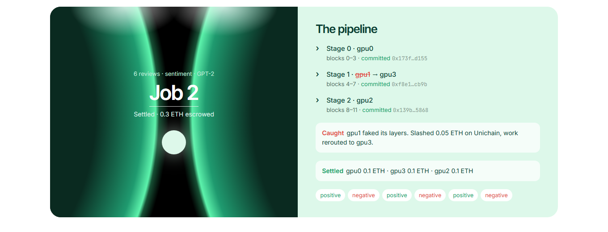

# LOOM

**Trustless pooled-GPU inference, refereed by Reactive Network.**

One AI model is split across several community GPUs, each running a slice of
its layers. Each GPU commits the hash of what it produced. If anyone challenges
the answer, a reactive contract on Reactive Lasna referees the dispute across
chains: it finds the GPU that cheated, slashes its bond on another chain, pays
whoever caught it, pays the honest GPUs, and reroutes the cheater's layers to a
standby GPU. There is no keeper bot, backend or human in the loop.

> Reactive Omni Buildathon · **Reactive Meets AI** track



---

## The problem

Pooled-GPU inference (one model sharded by layers across many cheap,
untrusted machines) makes big models affordable, but nobody can tell whether
each machine really ran its layers. A lazy GPU that skips half its work
produces a plausible-looking but wrong answer, and with several GPUs in a
pipeline you cannot even say which one was at fault. Today that means trusting
the operators or running a central checker.

## How LOOM works

```mermaid
sequenceDiagram
    autonumber
    participant B as Buyer
    participant E as LoomEscrow<br/>(Base Sepolia)
    participant R as LoomReferee<br/>(Reactive Lasna)
    participant G as GPUs 0..2
    participant W as Watcher agent
    participant V as Verifiers
    participant K as LoomBonds<br/>(Unichain Sepolia)

    K-->>R: ProviderBonded / ReputationUpdated (learns the GPU set)
    B->>E: createJob (payment escrowed)
    E-->>R: JobCreated
    R->>E: callback assignProviders (best-reputation bonded GPUs)
    G->>E: commitStage 0,1,2 (hash chain: out[i] = in[i+1])
    E-->>R: ResultProposed (challenge window)
    W->>W: re-runs the pipeline, finds stage 1 wrong
    W->>E: challenge (own trace + bond); divergence point = stage 1
    V->>E: vote (each re-ran stage 1 only)
    E-->>R: VerdictVote x2
    R->>E: callback resolveFault (quorum reached; reroute to standby GPU)
    E-->>R: FaultResolved
    R->>K: callback slash (bounty to watcher, compensation to buyer)
    G->>E: replacement recomputes stage 1, stage 2 recomputes
    Note over R: CRON: challenge window closes
    R->>E: callback settle (pay by layers served)
    E-->>R: JobSettled
    R->>K: callback recordSuccess (reputation)
```

1. **Split.** GPT-2 is cut into three stages (embedding + blocks 0–3, blocks
   4–7, blocks 8–11 + head). Each GPU only sees the activations handed to it.
2. **Commit.** Each GPU stores its output blob and commits its keccak256 on
   Base. The escrow enforces an unbroken chain: stage *i*'s input must be stage
   *i‑1*'s committed output.
3. **Challenge.** The watcher agent re-runs the pipeline. It accepts every
   stage it can reproduce and submits its own hash from the first stage it
   can't, so the on-chain divergence point lands exactly on the cheater.
4. **Verify one stage.** Verifiers re-run only the disputed stage from its
   agreed input and vote. A lazy GPU diverges by ~92 against a 0.01 tolerance.
5. **Referee.** `LoomReferee` counts the votes and, at quorum, wipes the faulty
   stage and everything after it, reroutes it to the best standby GPU, then
   slashes the cheater on Unichain once Base confirms. Unchallenged jobs settle
   when the window closes, paying each GPU by layers served.

## Why Reactive is essential

`LoomReferee` isn't a relay. It holds the protocol's state and makes every
decision after a job is posted:

| Decision | Inputs (events) | Output (callbacks) |
|---|---|---|
| Who runs each stage | bonds + reputation from **Unichain** | `assignProviders` on **Base** |
| Is a stage faulty | verifier votes from **Base**, counted to quorum | `resolveFault` / `rejectChallenge` on **Base** |
| Punish the cheater | `FaultResolved` on **Base** | `slash` on **Unichain** |
| Missed deadline | its own CRON clock | `timeoutStage` on **Base**, then `recordTimeout` on **Unichain** |
| Window closed | its own CRON clock | `settle` on **Base**, then `recordSuccess` on **Unichain** |
| Instruction lost or early | no confirming event yet | retried from CRON (destinations are idempotent) |

It listens on two origin chains, writes to two destination chains, and
subscribes to CRON **only while a job has a live timer**, unsubscribing when
nothing is pending, because CRON is billed every tick.

## Why it fits "Reactive Meets AI"

A neural network is part of the running system, not a development tool:

- the workload itself is GPT-2, executed stage by stage on the GPUs;
- verifiers are triggered by `Challenged` events and re-run the network, and
  their outputs decide what the reactive contract does next;
- the watcher agent decides whether an audit is worth the compute (unproven
  GPUs always, proven ones sampled) and when a challenge is justified.

Zero-shot GPT-2 is biased towards "positive" on its own, so a content-free
calibration row runs through the pipeline with the real data (Zhao et al.,
2021). That takes accuracy on our review set from 50% to 90%, and the
calibration row is verified like everything else.

---

## Quick start (local, about two minutes)

Requires [Foundry](https://getfoundry.sh) and Python 3.11+.

```bash
git clone --recurse-submodules https://github.com/Shivanikinagi/Loom && cd Loom
pip install -r requirements.txt
(cd contracts && forge build)
python -m loom.ml.fetch_model          # GPT-2 weights, 548 MB (or add --tiny below)

python -m loom local                   # 3 anvil chains, every actor, 3 scenarios
python -m loom local --interactive     # same network + dashboard at http://127.0.0.1:8080
```

`python -m loom local` deploys to three anvil chains (with the real chain IDs
and callback proxy addresses), runs the **fraud**, **honest** and **timeout**
scenarios, checks the outcomes on all three chains, and writes
`evidence/local-run.md`. See [a sample run](evidence/local-sample.md).

Locally, `loom/local_reactive.py` plays Reactive's part (it delivers logs to
`react()` and executes the callbacks). On testnet that file isn't used;
Reactive Lasna drives the same contracts.

## Testnet

| Contract | Chain | Address |
|---|---|---|
| LoomReferee (reactive) | Reactive Lasna (5318007) | _deploy pending_ |
| LoomEscrow | Base Sepolia (84532) | _deploy pending_ |
| LoomBonds | Unichain Sepolia (1301) | _deploy pending_ |

```bash
cp .env.example .env            # LOOM_PRIVATE_KEY = a fresh testnet-only key
python -m loom preflight        # checks RPCs, proxies and balances; prints what's missing
python -m loom faucet --eth 0.033  # Base Sepolia ETH -> lREACT on Lasna
python -m loom deploy  --network testnet
python -m loom fund    --network testnet   # tops up the derived role keys
python -m loom register --network testnet  # 5 GPUs bond on Unichain
python -m loom run --network testnet --scenarios fraud,honest,timeout --dashboard
python -m loom evidence --network testnet  # evidence/testnet.md with explorer links
```

One funded key runs everything: buyer, challenger, five GPUs and three
verifiers use keys derived from it. In total it needs about 0.06 Base Sepolia
ETH (half of it is swapped for lREACT) and 0.016 Unichain Sepolia ETH. Gas on
both is a fraction of a gwei, so role wallets get 0.001 ETH each and jobs pay
0.001 ETH.

No mainnet balance? The [Google Cloud faucet](https://cloud.google.com/application/web3/faucet/ethereum/sepolia)
and [QuickNode's Base faucet](https://faucet.quicknode.com/base/sepolia) work for
a fresh wallet. Ethereum Sepolia ETH can be bridged to either chain through
its standard bridge.

## Tests

```bash
cd contracts && forge test           # 16 tests incl. fuzz + conservation
python -m pytest -m "not e2e"        # ML pipeline (real GPT-2 test runs if weights exist)
python -m pytest -m e2e              # full local network, all scenarios (~2 min)
```

The Foundry suite runs the whole loop through a simulated Reactive relay: logs
are delivered to `react()` from the system address, callbacks are executed
through the proxy with the sender injected, and the proxy's gas overhead is
withheld. It covers the happy path, fraud caught and rerouted, frivolous
challenge, missed deadline, no quorum, refund, reputation-based scheduling,
early and duplicate callbacks, authentication, fee isolation, a settlement fuzz
test, and a conservation test that keeps every `react()` under Reactive's 900k
gas cap (worst case: 458k).

## Design notes

- **Fees can't touch user money.** Callback fees are paid only from the
  operating balance; escrow, challenge bonds and provider bonds are excluded
  (`LoomCallbackBase.locked()`).
- **Callbacks are idempotent.** A stale or early instruction emits
  `CallbackIgnored` instead of reverting, and the referee retries until the
  confirming event arrives. Clock skew between chains can't strand a job.
- **Offline isn't fraud.** A missed deadline costs a small fixed penalty and
  the stage is rerouted. Only a verifier quorum can slash.
- **Frivolous challenges cost the challenger.** If the quorum says the GPU was
  honest, the challenger's bond goes to the accused.
- **Cross-chain ordering.** Unichain is only slashed after Base confirms the
  fault, so the two chains can't disagree.

## Trust assumptions and limits

- **Verifier set.** The verifier set is owner-managed and needs 2 of 3 votes. A
  production version would bond verifiers and sample them per dispute.
- **Determinism.** Verification relies on deterministic inference on a common
  software stack (NumPy float32). Honest re-runs are bit-identical here, and a
  tolerance absorbs harmless drift. Heterogeneous hardware would need a
  reproducibility layer such as Gensyn's RepOps.
- **Data availability.** Blobs live in a content-addressed store. It's untrusted
  for integrity (everything is re-hashed against the chain), but a provider
  that withholds data is voted faulty.
- **Payments.** Payments are native ETH on testnet.

**Prior art.** Optimistic fraud proofs for ML ([opML](https://arxiv.org/abs/2401.17555))
and re-executing only the disputed step ([Gensyn Verde](https://gensyn.ai/articles/verde))
inspired the dispute design. LOOM's contribution is applying it to
layer-sharded inference with a reactive contract as the cross-chain referee,
settling in seconds rather than over a long dispute game.

## Repository

```
contracts/src/LoomReferee.sol      reactive contract (Lasna): scheduling, quorum, timers, retries
contracts/src/LoomEscrow.sol       buyer chain (Base): jobs, commitments, challenges, votes, payouts
contracts/src/LoomBonds.sol        provider chain (Unichain): bonds, slashing, reputation
contracts/src/LoomCallbackBase.sol callback auth + fee isolation
contracts/test/                    full-loop tests through a simulated Reactive relay
loom/ml/                           NumPy GPT-2, stage pipeline, commitments, calibration
loom/roles.py                      provider, verifier, watcher agent, buyer
loom/indexer.py                    cross-chain state mirror
loom/local_reactive.py             local stand-in for Reactive (anvil only)
loom/dashboard.py, web/            live dashboard
loom/evidence.py                   tx-hash timeline + loop latencies
docs/ARCHITECTURE.md               events, callbacks, state machine
```

## License

MIT
