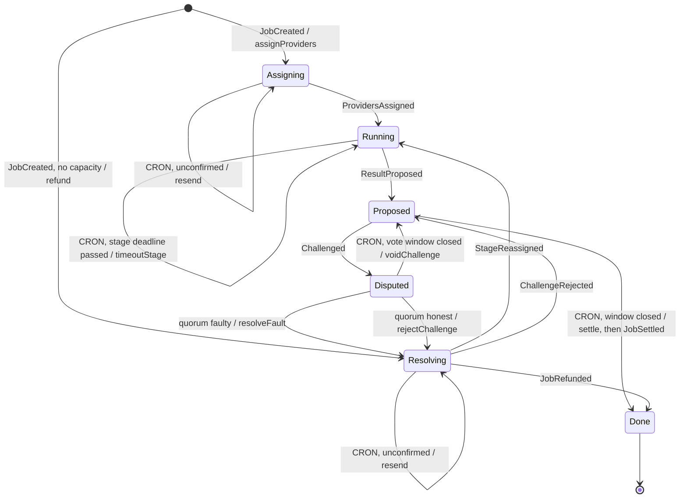

# LOOM architecture

## Chains and contracts

| Contract | Chain | Role |
|---|---|---|
| `LoomReferee` | Reactive Lasna (5318007) | Reactive contract. Mirrors jobs and providers from events and makes every decision. |
| `LoomEscrow` | Base Sepolia (84532) | Buyer chain. Payments, stage commitments, challenges, votes, payouts. Callback recipient. |
| `LoomBonds` | Unichain Sepolia (1301) | Provider chain. Bonds, slashing, timeout penalties, reputation. Callback recipient. |

Deployment order follows the Reactive docs: the referee first, then the two
callback contracts with the referee's address baked in as their only
authorised sender (`_CALLBACK_SENDER`), then `setTargets()` on the referee,
which opens 19 subscriptions (13 escrow events, 6 bond events).

## Subscriptions → decisions → callbacks

| Origin event | Referee does | Callback |
|---|---|---|
| `ProviderBonded`, `ProviderExiting`, `ProviderWithdrawn`, `ProviderSlashed`, `ProviderTimedOut`, `ReputationUpdated` (Unichain) | Updates its provider table (bond, exiting, barred, jobs, faults, timeouts) | none |
| `JobCreated` (Base) | Picks `nStages` distinct eligible GPUs by score `jobs − 10·faults − 3·timeouts` | `assignProviders` → Base, or `refund` if there aren't enough |
| `ProvidersAssigned`, `StageCommitted`, `StageReassigned` (Base) | Arms the stage deadline timer | none |
| `ResultProposed` (Base) | Arms the challenge-window timer | none |
| `Challenged` (Base) | Resets the tally, arms the vote-window timer | none |
| `VerdictVote` (Base) | Counts once per verifier per round; at quorum, decides | `resolveFault(replacement)` or `rejectChallenge` → Base |
| `FaultResolved` (Base) | The fault is confirmed on the buyer chain | `slash` → Unichain |
| `StageTimedOut` (Base) | The timeout is confirmed on the buyer chain | `recordTimeout` → Unichain |
| `JobSettled` (Base) | Job done; stops its timer | `recordSuccess` → Unichain |
| `Cron10` (Lasna) | For each live timer past `deadline + GRACE` | `timeoutStage` / `settle` / `voidChallenge`, or resend the pending instruction |

## Referee job state machine

Every timed phase stores a deadline measured on the **destination** chain's
clock (taken from the event). The referee only acts at `deadline + GRACE` (4 s)
and at most once per `RETRY` (30 s). The escrow re-checks the deadline against
its own clock and ignores early instructions, so clock skew can delay an action
but can't break it.

Pending instructions are stored as a one-byte action code plus one address and
re-encoded on retry. That keeps the costliest `react()` (`JobCreated`: provider
selection, pipeline storage, CRON subscription, callback) at 458k gas in tests,
about half Reactive's 900k cap.

## Dispute protocol

1. Stage *i* commits `(inHash, outHash)` and the escrow requires
   `inHash == out[i-1]` (or the dataset hash for stage 0).
2. A challenger posts a full trace `claimed[0..n-1]` and a bond. The escrow
   finds the first `d` with `claimed[d] != out[d]`. Both sides agree on stage
   *d*'s input, so only stage *d* needs re-running.
3. Registered verifiers re-run stage *d* from its input blob and vote `faulty`
   if the committed output differs by more than the tolerance, or if its blob
   is unavailable or doesn't match its hash.
4. At 2 of 3 votes the referee resolves:

| Outcome | Challenger | Accused GPU | Buyer | Stage *d*.. |
|---|---|---|---|---|
| Faulty | bond back + 50% of slashed bond | whole bond slashed, barred | 50% of slashed bond, correct result | wiped, rerouted to standby |
| Honest | loses bond | receives challenger's bond | result stands | unchanged |
| No quorum by vote deadline | bond back | nothing | result stands | unchanged |

## Gas (from `forge test --gas-report`)

| Function | Gas (median) |
|---|---:|
| `createJob` | 167k |
| `commitStage` | 84k |
| `challenge` | 94k |
| `resolveFault` (callback) | 95k |
| `settle` (callback, 3 payouts) | 87k |
| `slash` (callback) | 60k |
| worst `react()` | 458k |

## Off-chain actors

All actors are independent processes in principle. In the demo they run as
threads of one program, each with its own key. None of them can change what
happens next; they only send transactions any participant could send.

| Actor | Trigger | Action |
|---|---|---|
| Provider | its stage is next | fetch input, verify its hash, run layers, store blob, `commitStage` |
| Watcher | `ResultProposed` | audit policy → re-run pipeline → `challenge` from the first wrong stage |
| Verifier | `Challenged` | re-run the disputed stage → `vote` |
| Buyer | user | store dataset → `createJob` |
